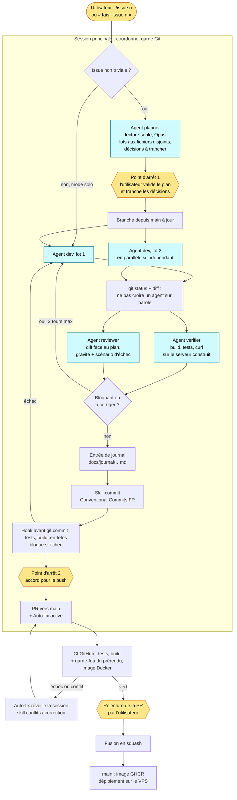

# Workflow de développement agentique

Comment une issue devient du code en production dans ce projet, et ce que ce workflow vaut face aux pratiques publiées (état au 2026-11-17).

## Le workflow

**Ce qui sert de « savoir »** : les agents (`.claude/agents/`) portent les rôles, et les skills (`.claude/skills/`) portent les règles. `conventions-analog`, `bff-spring`, `tests-analog`, `review-analog`, `analogjs` (officiel), `angular-developer`, `commit`, `conflits` et `issue`. Une règle s'écrit une fois, et l'agent qui code applique la même que celui qui relit.

**Ce qui est garanti par la machine, pas par l'agent** : hook qui bloque tout `git commit` si les tests, le build ou les en-têtes échouent ; outils en lecture seule pour `planner`, `verifier` et `reviewer` ; garde-fou du prérendu (`postbuild`) ; builds client puis SSR enchaînés ; validation des en-têtes de skills ; CI rouge si quelque chose casse.

## Comparaison avec les pratiques publiées

| Pratique publiée | Source | Ici |
|---|---|---|
| Explorer, planifier, coder, commiter ; séparer l'exploration de l'exécution | Anthropic, guide officiel | ✅ `planner`, puis validation, puis `dev`, puis `commit` |
| Donner à l'agent une vérification qui répond « passe » ou « échoue », et demander la preuve | Anthropic | ✅ `verifier` avec tests, build et `curl` ; le hook avant commit l'impose (A) |
| Relecteur qui n'a pas vu l'écriture du code, sans droit d'écrire | Anthropic | ✅ `reviewer` en lecture seule, frais |
| Relire **face à la spec**, en ignorant le style (sinon on corrige des faux problèmes) | Anthropic | ✅ relecture face au plan ; « ce qu'il ne faut pas signaler » dans `review-analog` |
| Ce qui doit **toujours** arriver va dans un hook, pas dans `CLAUDE.md` | Anthropic | ✅ hook avant `git commit` (A) |
| `CLAUDE.md` court ; procédures d'équipe dans des skills | Anthropic | ⚠️ procédures dans des skills, mais `CLAUDE.md` est long (voir E) |
| Spec écrite et versionnée (spec → plan → tâches), qui sert de référence à la relecture | GitHub Spec Kit | ⚠️ le plan existe mais n'est pas conservé : il vit dans la conversation (voir B) |
| Planificateur, codeur, testeur, relecteur, chacun avec un rôle strict et des outils limités | AgentMesh, guides multi-agents | ✅ quatre rôles, outils limités |
| Boucle de correction bornée entre relecteur et codeur | Guides multi-agents | ✅ deux tours au maximum, puis l'utilisateur tranche |
| Un modèle par rôle, selon le besoin et le coût | Anthropic, guides multi-agents | ⚠️ seul `planner` fixe Opus (voir D) |
| Sessions parallèles isolées (worktrees) | Anthropic | ⚠️ les agents partagent un seul dossier (voir C) |
| Agent dans la CI qui corrige seul | GitHub Actions (`claude-code-action`) | Écarté volontairement : coût, clé d'API, poussées sans relecture. Auto-fix de l'app à la place. |

**Ce que ce projet fait en plus** : deux points d'arrêt humains explicites ; un journal qui garde aussi les erreurs de l'agent ; un `verifier` qui teste le **serveur construit** plutôt que de se contenter des tests unitaires. C'est lui qui a trouvé les pages prérendues vides et le contournement du relais.

## Améliorations proposées

Chacune répond à un incident réel de ce projet.

**A. Rendre les vérifications obligatoires par un hook** *(fait le 2026-11-17)*
Deux fois, une vérification « demandée » a été sautée. Un agent `dev` a annoncé « build OK » sans lire les erreurs du prérendu. La session principale a commité alors que son build avait échoué, parce que sa condition testait la présence d'une ligne et non son résultat. Le guide d'Anthropic est clair : ce qui doit toujours arriver va dans un hook. Proposition : un hook `PreToolUse` sur `git commit` qui lance `npx vitest run && npm run build` et bloque le commit si ça échoue. C'est quelques lignes dans `.claude/settings.json`, et ça s'applique à toutes les sessions et à tous les agents.

*Fait* : `.claude/hooks/verifier-avant-commit.mjs`, déclaré en `PreToolUse` sur `Bash`. Il ne réagit qu'à `git commit`, puis lance l'une après l'autre les étapes tests, build (avec le contrôle du prérendu) et en-têtes. En cas d'échec, il bloque avec le code 2 et renvoie les 40 dernières lignes à l'agent. Essayé sur quatre cas : commande ordinaire ignorée, dépôt sain autorisé, test cassé bloqué, prérendu vide bloqué.

**B. Garder le plan validé dans le dépôt ou sur l'issue** *(priorité moyenne)*
Le plan du `planner` et les décisions validées ne vivent que dans la conversation. Le `reviewer` les reçoit recopiés dans son brief, et ils disparaissent ensuite. Proposition, version légère de Spec Kit : poster le plan validé en commentaire de l'issue (`gh issue comment`). Le `reviewer` le lit là, et l'oral garde la trace de chaque décision.

**C. Isoler les agents qui construisent** *(priorité moyenne)*
Le `verifier` et le `reviewer` ont lancé des builds et des tests en même temps dans le même dossier. Cette charge a fait apparaître la course du plugin, et a d'abord égaré le diagnostic vers le nom d'un fichier. La course est corrigée, mais le partage reste : `dist/` commun et ports locaux. Proposition : `isolation: worktree` pour le `verifier`, ou la règle « un seul agent construit à la fois ».

**D. Choisir le modèle selon le rôle** *(priorité basse)*
Le `verifier` exécute surtout des commandes et compare des codes HTTP. Un modèle plus léger (Sonnet) suffit et coûte moins cher. Le `planner` et le `reviewer` gagnent à rester sur le plus fort.

**E. Raccourcir `CLAUDE.md`** *(priorité basse)*
Le guide d'Anthropic note qu'une règle se perd dans un `CLAUDE.md` long. Le nôtre mêle des règles permanentes et de l'historique : décisions datées, périmètre, production. On peut y laisser l'essentiel (commandes, interdits, workflow) et renvoyer le reste vers `docs/` et les skills.

**À ne pas faire** : multiplier les agents. Les guides conseillent de commencer simple et de n'ajouter un rôle que quand le précédent échoue. Le projet l'a vérifié deux fois : la relance en CI et l'idée d'un agent correcteur traitaient le symptôme, alors qu'une règle à la source réglait le problème.

## Sources

- [Best practices for Claude Code](https://code.claude.com/docs/en/best-practices) : vérifications, hooks, sous-agents, relecture face à la spec
- [Claude Code: Best practices for agentic coding](https://www.anthropic.com/engineering/claude-code-best-practices) : explorer, planifier, coder, commiter
- [Spec-driven development with AI (GitHub Spec Kit)](https://github.blog/ai-and-ml/generative-ai/spec-driven-development-with-ai-get-started-with-a-new-open-source-toolkit) : spec, plan, tâches, implémentation
- [AgentMesh : framework multi-agent pour le développement](https://arxiv.org/html/2507.19902v1) : planificateur, codeur, débogueur, relecteur
- [Multi-agent AI software development](https://www.augmentcode.com/guides/multi-agent-ai-software-development) : commencer simple, rôles stricts
- [Code generation pipeline : 5 specialized agents](https://callsphere.ai/blog/code-generation-pipeline-5-specialized-agents-planner-coder-reviewer-tester-deployer) : contrats de passage entre agents, boucle bornée
